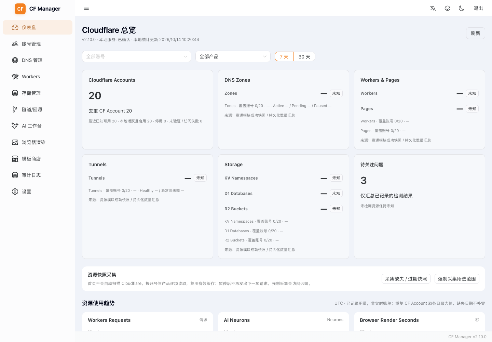
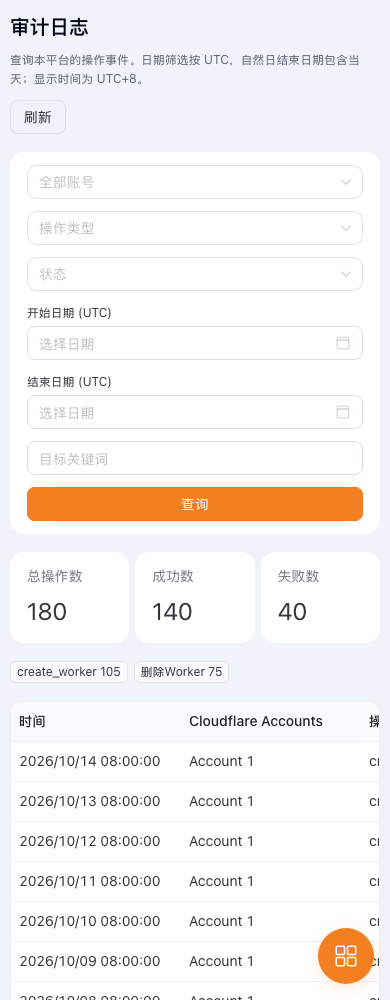

# v2.10 Dashboard、审计中心与公共查询

基线为 v2.9.0 / `c7beed928915f3c4793a6962a4489dd941cf528a`，初始工作区干净。按 A 数据层 → B 总览与审计页验收 → C Catalog → D Accounts → E 回归实施。没有新增运行依赖、生产调用、提交、推送或部署。

## 信息架构与来源

首页为六类概览卡片、三种分单位用量趋势、审计成功/失败趋势与类型分布、关注事项、每页 10 条账号列表、只读账号详情及最近 6 条活动。支持账号、资源产品、7/30 天筛选（产品仅影响资源卡片与采集范围，不改变审计/用量的统计定义）；资源入口携带本地 accountId，DNS / Workers / Storage / Tunnel 页面使用该上下文。审计完整筛选移至 `/audit-logs`，桌面/移动导航及中英文消息均已接入。

| 数据 | 真实来源 | 语义与限制 |
|---|---|---|
| 绑定/去重 CF Account、启用/停用、验证状态 | accounts JOIN credentials，SQLite / D1 | 无 CF 请求；未绑定的本地记录不冒充真实 CF Account |
| 账号访问/凭证状态 | 最近一次保存的检测结果 | 不是本次远端健康检查；长期未检测单独提示 |
| Zone / Workers / Pages / Tunnel / KV / D1 / R2 数量 | 现有资源模块成功完整列表，以及 resource_summaries 数量快照 | 不读取 DNS 记录、R2 对象、KV 值、Tunnel 配置或 Secrets 来统计数量 |
| Zone active/pending/paused，Tunnel healthy/异常或未知 | 完整列表的实际状态字段 | 缺少状态不推断为健康；不把本地 health 成功当远端健康 |
| Workers Requests / AI Neurons / Browser Render Seconds | quota_usage 历史记录 | 请求、Neurons、秒分别绘图；UTC 自然日；缺失日期不补零 |
| 操作成功/失败、类型分布、最近活动 | audit_log | 仅代表本平台审计事件，不代表 CF 总请求量或 API 错误率 |
| Catalog 异常 | catalog_sources.last_status，以及 Catalog API 的 sync 元数据 | 旧数据库没有错误检测时间，首页显示未知时间；不使用上次成功时间冒充失败检测时间 |

`quota_usage` 历史表没有完整的来源/同步时间字段，混有本地估算与曾同步用量。重复真实 CF Account 的同日同指标取 MAX，明确标注这一聚合定义；不能据此还原实际账单，也不能保证覆盖所有请求。Dashboard 不返回官方额度或百分比。原 LIMITS 为内部策略，旧配额接口保留兼容并增加 limitSource / officialLimit:null / usageSource / syncedAt:null / period；不改变既有路由和耗尽标记。Workers 页移除所有账号共用的 100000 分母，Accounts 的 AI 列也只显示已记录 Neurons 与耗尽标记，不再把内部策略当官方百分比。

## 数据层、身份与新鲜度

`shared/auditQueries.ts`、`dashboardData.ts`、`dashboardCollector.ts` 是双端唯一源码；`localSql.ts` 分别适配同步 SQLite 与异步 D1。服务端业务/响应结构共用，生成副本由 sync-shared 管理，Docker COPY 同步。

每项资源指标包含 metric、value、state、source、fetchedAt、lastSuccessAt、complete、coveredAccounts、totalAccounts、errorKind 与必要状态计数。无值为 null，未知显示 `—`；没有任何相关账号的空范围可以确认数量为 0。本地启用与最近已知可用单独计数，未验证但本地启用的记录不能计为已验证可用。停用、访问失败、未绑定的记录仍保留在统计覆盖范围中，不能因它们暂时不可采集而报告完整零资源。

- 按真实 CF Account + 产品 + 资源 ID/名称去重。一个账号有多个凭证绑定时选最近一次完整成功读取，不累加绑定数量；另一绑定失败不会抹掉已确认资源。账号概况仍保留独立本地绑定。
- 快照只保存数量、少量状态计数、时间、CF Account ID 和 SHA-256 身份摘要；不保存 Token、Key、Email、代理认证、环境变量或完整资源 JSON。身份沿用 bindingSignature，包含真实账号、凭证密文/ID、更新与代理版本。
- 删除绑定由外键级联删除汇总；凭证/身份变化后的旧行不参与统计。采集结束前再次核实绑定身份，迟到结果不能安装到已删除/已变化的绑定。
- 5 分钟内的成功数量快照可标 ready，之后 stale。ready 表示该时间点的完整快照仍在展示有效期内，不表示实时资源健康；外部或其他 isolate 的变更可能在有效期内尚未反映。
- 部分覆盖显示“已确认至少 N 个”和覆盖比例；有旧成功数据的读取失败保留数量和原 lastSuccessAt，标 stale 并列出问题。缓存 peek 同时携带真实失败时间，不能把旧缓存重新盖成刚成功。
- DNS、Workers/Pages、Tunnel、D1 可直接 peek 当前模块缓存，peek 不触发 revalidation。KV/R2 没有可确认的完整列表快照时保持未知，允许显式采集；不把单页当完整资源总数。

首次进入先显示本地统计与可用快照，**不自动启动全账号/全产品采集**。“采集缺失/过期”按绑定/产品逐项读取，重复 CF Account 成功后跳过其他凭证；失败可继续尝试另一凭证。“强制采集所选范围”绕过普通成功缓存，仍沿用原模块的限速/429 冷却。暂停停止下一项请求，已开始的只读请求可完成；切换账号或退出会隔离迟到响应。有效持久快照直接复用；确需采集时等待完整读取，不把模块 SWR 的后台承诺当成采集完成（Worker invocation 不能在未确认时返回成功）。采集复用原调度器的 background 优先级，不建立进程后台任务或跨 isolate 全局锁。

每次 collect 只处理一个绑定/产品，最多 35 个实际上游读取；请求遵守约 25 秒采集期限及原调度器 deadline，不保存超预算的部分列表。特别大的完整列表若超过此预算，保持未知/旧快照；可先在对应资源页完成正常读取，再复用成功缓存。Worker 的 singleflight 仅在当前 isolate/DB 有效，持久数量由 D1 保存；不承诺跨 isolate 合并、事务快照或即时写后计数。CF 写入/归属预检查、原有缓存与防重放机制保持。

## API

所有新增接口位于已认证的 `/api` 内，返回原 `{success,data}` 包装，禁止 HTTP 缓存。

| 接口 | 功能 |
|---|---|
| GET /dashboard/overview?accountId= | 本地元数据、账户计数、今日已记录用量与本地关注事项 |
| GET /dashboard/resources?accountId= | 快照聚合、覆盖与逐绑定统计，零 CF 请求 |
| GET /dashboard/trends?days=7\|30&accountId= | UTC 用量历史与共享审计聚合 |
| GET /dashboard/activity?accountId= | 最近 6 条安全审计记录 |
| POST /dashboard/collect | `{accountId,metric,refresh?:boolean}`，显式单项只读采集 |
| GET /audit-log/page | 稳定游标查询；accountId/action/status/startDate/endDate/target/cursor/limit |
| GET /audit-log/stats | 与趋势相同的审计聚合实现，接受相同筛选（不含 cursor） |
| GET /accounts/options?feature= | 独立于 AccountsView 分页的轻量元数据数组 |
| GET /store/templates?cacheOnly=true&sourceId= | 缓存优先或逐源 Catalog，原 templates/sources 形状保留，sources 增加 sync |
| POST /store/refresh | 可选 `{sourceId}`；缺省刷新全部启用源 |

`metric` 为 zones / workers / pages / tunnels / kv / d1 / r2。旧 /accounts、/audit-log 数组查询、账户编辑/检测/导入导出和 Store 预检/部署/批量/回滚入口保留。

审计按 `created_at DESC,id DESC` 排序，游标带首次查询 MAX(id) 锚点、上条时间/ID 与完整筛选范围；后续新增记录在刷新后出现。没有深 OFFSET，同秒事件不会跳页或重复。时间使用 UTC，日期结束值包含当天，ISO 时间戳使用半开区间；UI 显示时间明确为 UTC+8。目标搜索转义 LIKE 通配符。limit 默认 50、最大 200。

详情只回传安全状态枚举、数量、布尔值；旧自由文本、环境变量和敏感配置全部隐藏，不能为详情重新调用远端 API。旧数组接口也共用读取脱敏。审计统计里的数字 success 必须在路由显式包为 `{success:true,data:stats}`，否则现有 responseWrapper 会误认它为外层状态；双端 HTTP 回归已覆盖这一边界。

## Catalog 与账号公共数据

CatalogReader 逐跳使用原 SSRF guard，禁止远端重定向转至本地调试地址；Node 保留原 localhost HTTP 调试入口，Worker 继续要求 HTTPS 并传入 allowlist。每候选源 8 秒总期限、5 MiB 流式体积上限、最多 3 次重定向；同源 Singleflight、全局最多 3 个正在刷新源。默认源保留原三地址 fallback，自定义源只读自己的 URL。

空目录也是有效成功。ETag 仅随对应 URL 的已缓存表示发送，304 缺少表示时明确失败；创建/改源时保留重定向最终 etagUrl，不能把目标站 validator 发给另一来源。强刷不预删成功快照；失败区分 http_403/429/500、timeout、schema、json、size、redirect 等。状态为 ready / empty / stale / unknown / error，成功时间和尝试时间分开。单源成功只替换该源；删除/改 URL 与 pending 读取均有身份/世代隔离。

Docker 使用有界内存（100 源/估算 16 MiB）；Worker 使用 isolate 内存 + KV 7 天保留成功快照，5 分钟展示有效期。KV key 含源 ID 与 URL，旧无身份的 KV 格式不作为新表示使用。跨 isolate 的强刷一致性仍受 KV 传播约束；大量源的全源刷新与 scheduled handler 仍须服从实际 Worker invocation 子请求限额，超大配置应使用逐源刷新。没有增加 Redis 或分布式采集器。

Store 首次 cacheOnly 后最多 3 个逐源请求，成功源逐项显示；全部刷新也由前端逐源 POST，避免一个 Worker invocation 承担所有源并逐项显示新快照；空目录不再自动强刷。单源刷新与列表请求有响应身份隔离。README 打开详情才读，HTTPS、8 秒、1 MiB、最多 20 项/估算 2 MiB 的组件内缓存；关闭/切换/退出取消并拒绝迟到响应；原 MarkdownRenderer 的 DOMPurify/链接处理保留。不可读时使用原模板简介，不执行第三方 HTML。

/accounts/options 仅 SELECT 所需元数据，返回本地 ID、名称、CF ID、credential_id、启用/访问状态、功能、必要套餐/R2 能力提示、is_demo 和安全 identity_version；不返回凭证明细、配额、Email、密钥或代理 URL。identity_version 对认证指纹/代理等哈希，不暴露这些原值。前端 30 秒按 feature 缓存/Singleflight，返回独立副本；账户/凭证修改只失效元数据缓存，退出和认证失效拒绝旧响应。AccountsView 的分页数据/搜索和 Demo 缓存也在退出时清理。DNS 用全量轻量元数据维护完整 Demo 标记；页面仍按 DNS 功能筛选。凭证名称继续从 /credentials 权威关联，不能用名称猜测。

## 升级与回滚

本轮 0013 为加法变更：resource_summaries、审计 created_at/id 及 account/status/action 复合索引、quota_usage 日期索引。SQLite 初始化同步建表/索引并记入 `_migrations`；索引必须位于依赖表创建之后。D1 当前完整 schema 与版本 SQL 同步，Schema 检查已通过；无依赖、密文格式、Account 主键或历史审计/配额变化。

部署时保留现有 API_SECRET、ENCRYPTION_KEY、Credential、Account 与代理配置，先备份 SQLite 数据卷 / D1。D1 **先迁移再发布前后端**：在 worker 目录按实际库名运行 `D1_NAME=<实际库名> npm run db:migrate`（现有脚本默认 remote，并记录版本），确认 0013 已应用。SQLite 由应用启动幂等迁移。随后整体发布 2.10.0，检查本地 health、四个 Dashboard GET、分页和真实 Token/Global Key 的只读资源权限。本次没有执行远端迁移或部署。

回滚可整体切回 v2.9.0 产物，保留新增表/索引及数据卷；旧程序不依赖这些对象，不需要 DROP 表。需要恢复升级前精确数据库状态时停写并恢复完整备份。应用回滚不撤销任何 CF 远端写入；本轮采集为只读，没有自动修复/备份/清理。

## 验证与复现

A/B gate 先通过 810 项测试（377 / 325 / 108）、三端类型/Lint 0 errors、三端构建/Worker ZIP/Schema 和 32 组浏览器检查后再推进 C/D。最终结果及性能表见下文和原始 JSON。没有用合成结果声称生产 P95、计费或内存容量。

```sh
node scripts/sync-shared.js
npm --prefix backend test
npm --prefix worker test
npm --prefix frontend test
npm --prefix backend run typecheck
npm --prefix worker run typecheck
npm --prefix frontend run typecheck
npm --prefix backend run lint
npm --prefix worker run lint
npm --prefix frontend run lint
npm --prefix backend run build
npm --prefix frontend run build
npm --prefix worker run build
node scripts/check-db-schema.mjs
node scripts/benchmark-dashboard.mjs
```

浏览器脚本使用已有或临时安装的 Playwright，生产依赖未增加。设置 PLAYWRIGHT_MODULE 为它的实际模块路径，CHROMIUM_EXECUTABLE 可选；完整 Worker build 会重建 frontend/dist，**等待所有构建完成后**再运行，脚本会冻结副本。

```sh
PLAYWRIGHT_MODULE=/path/to/playwright node scripts/test-dashboard-ui.mjs
PLAYWRIGHT_MODULE=/path/to/playwright node scripts/test-catalog-ui.mjs
PLAYWRIGHT_MODULE=/path/to/playwright node scripts/benchmark-dashboard-ui.mjs
PLAYWRIGHT_MODULE=/path/to/playwright UI_REPORT=docs/regression-v2.10-workers-ui.json node scripts/test-v2.7-ui.mjs
PLAYWRIGHT_MODULE=/path/to/playwright UI_REPORT=docs/regression-v2.10-storage-ui.json node scripts/test-v2.8-ui.mjs
PLAYWRIGHT_MODULE=/path/to/playwright UI_REPORT=docs/regression-v2.10-tunnels-ui.json node scripts/test-tunnels-rules-ui.mjs
PLAYWRIGHT_MODULE=/path/to/playwright node scripts/test-dns-ui.mjs
PLAYWRIGHT_MODULE=/path/to/playwright node scripts/test-scroll-ui.mjs
docker build --platform linux/arm64 -f docker/Dockerfile -t cf-manager:codex-dashboard-v210 .
node scripts/test-docker.mjs cf-manager:codex-dashboard-v210
```

原 DNS 浮层测试迁移日期控件至审计页，保留 reduced-motion / no-preference / 100%/125%/150% 覆盖；旧首页配额墙已移除，滚动 Popover 改测保留的 Workers 卡片，Tooltip 改测 Accounts。长列表 Catalog 夹具补齐真实 source 元数据，并拦截 HTTPS README；没有删除这些场景来绕过失败。

视觉验收发现 Grid 隐式 auto 列会被宽表撑开，外层 overflow-x:hidden 使 document.scrollWidth 断言仍通过；总览/审计显式 minmax(0,1fr)，并检查所有直接模块的实际 right 边界。1440 / 1024 / 768 / 390 px、深浅主题均检查；截图为合成测试数据。

## 后续 v3.0

- 为新写入用量增加来源、采样时间、聚合范围与套餐验证元数据；历史无来源数据保持原样，不回填伪造来源。
- 如真实环境数据证明需要，再设计跨 isolate 的快照失效/采集游标与持久操作回执；维持手动、可暂停的采集边界。
- 用真实 CF/D1 的只读采样确定索引、chunk 和缓存优化优先级；套餐计费、自动清理/备份和大规模分布式采集另行设计。

## 最终验收结果与合成性能

- 三端 **879 项测试通过**：backend 408、worker 356、frontend 115；原 764 项保留，新增 115 项。覆盖 0/20/60/120 账号、重复凭证/资源、全部未知/部分/完整/过期、强刷、失效/退出/迟到响应、付费限额、UTC 边界、100/1000/100000 审计遍历/并发新增/索引/脱敏、Catalog 错误/304/空/并发/超时/重定向/失败编辑、README 身份等。
- 三端类型检查、Lint 0 errors、backend/frontend 构建、完整 Worker/admin 构建及 ZIP、DB Schema 与 git diff --check 通过。保留 any/样式 warnings 和大 chunk 提示。
- 总览/账号详情/审计 32 组（四宽度 × 深浅 × 四账号规模）；商店 4 组；原 DNS 单/跨 Zone、浮层/缩放、分页/Workers/Pages、Zone/Storage/D1、Tunnels/Rules 和四尺寸长列表滚动通过。报告保存为本轮新 JSON，旧报告未覆盖。
- Linux ARM64 镜像及隔离启动/迁移/持久化/非 root/read_only/权限矩阵通过，并检查新 Dashboard / 审计 / options 实际容器端点。
- 本地 Node 24.21.0，CI 定义仍为 Node 22；本轮没有触发云 CI。未使用真实 CF 凭证、执行真实 D1 迁移、生产代理/权限/套餐或原生 AMD64 验收，未提交、推送或部署。

本地 HTTP 夹具每项 40 样本（Node 实验服务器 + 实际聚合与 SQLite，不含完整 Express/Hono 认证栈）；旧接口为原始 v2.9 getQuotaSummary，新接口为更丰富的 overview，业务范围不同。单位 ms：

| 账号 | 旧本地配额 HTTP P50/P95 | 新总览 HTTP P50/P95 | 旧配额聚合 P50/P95 | 新总览聚合 P50/P95 |
|---:|---:|---:|---:|---:|
| 0 | 0.326 / 0.813 | 0.362 / 1.086 | 0.016 / 0.017 | 0.057 / 0.063 |
| 20 | 0.443 / 0.639 | 0.671 / 1.165 | 0.144 / 0.192 | 0.189 / 0.208 |
| 60 | 1.025 / 1.472 | 0.897 / 1.238 | 0.517 / 0.615 | 0.329 / 0.481 |
| 120 | 1.907 / 2.373 | 1.144 / 1.593 | 1.491 / 1.713 | 0.586 / 0.781 |

小规模新总览的本地开销可能增加；120 账号的本次本地样本改善不能外推为生产收益。旧版首屏 CF 调用同样为 0；新版新增资源统计后仍为 0，内部本地 API 从 3 个变为 5 个。

10 万条审计每页 100 条的本地参考 OFFSET（含同样 JOIN/读取脱敏）P95 16.888 ms，游标 P95 1.543 ms。v2.9 原接口没有深分页，这是参考 SQL，不是宣称旧版存在该分页接口。

浏览器以下为每场景一次的桌面 1440px/light 取样，包含启动/解析/布局/本地请求，不能称为浏览器生产 P50/P95。heap 未强制 GC，不是容量上限；图表时间是从导航至真实 SVG 出现（排除空状态图标），并非单独图表 CPU 时间：

| 账号 | 首个有效内容 ms 旧→新 | JS gzip KiB 旧→新 | 初始 heap MiB 旧→新 | 新图表可见 ms |
|---:|---:|---:|---:|---:|
| 20 | 284.8 → 224.1 | 391.1 → 396.1 | 35.80 → 10.98 | 225.3 |
| 60 | 282.3 → 198.4 | 391.1 → 396.1 | 44.93 → 11.14 | 199.5 |
| 120 | 283.1 → 206.9 | 391.1 → 396.1 | 43.60 → 11.61 | 208.0 |

没有新增图表依赖，使用可访问 SVG 与数值明细。首屏 JS 因新视图/消息/元数据缓存略增，不能声称所有性能指标都降低。原始资料：performance-v2.10.json、performance-v2.10-ui-before.json、performance-v2.10-ui.json、performance-v2.10-chunks-before.json；含 20/60/120 账号、手机/平板/深浅与空数据案例。

下图均为隔离合成数据首屏，未知资源不会显示虚构数量：




